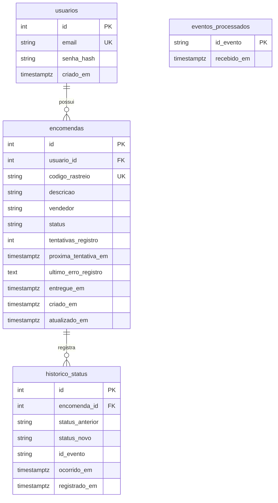
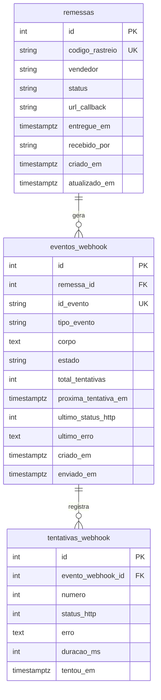

# HookLog: modelo de dados

Versão 1.2 · 24/11/2026

Cada serviço tem o **seu próprio PostgreSQL 16** (contêineres, volumes e credenciais separados). Nenhum serviço lê o banco do outro. A única ligação entre os dois é o valor do código de rastreio (`codigo_rastreio`, o mesmo nome nos dois bancos), trocado pela API e pelo webhook.

## 1. Convenções

- **Nomes em português** (tabelas, colunas e classes dos models), conforme a regra do `AGENTS.md`.
- **O ADMIN não existe no banco.** Ele é mockado por `ADMIN_EMAIL` e `ADMIN_SENHA` no `.env`. A tabela `usuarios` guarda **somente usuários `USER`**, e por isso não tem coluna de papel. O papel (`USER` ou `ADMIN`) é um enum no código (`Papel`) usado no token JWT e no controle de acesso.
- **Enums como `VARCHAR` + `CHECK`**, e não `ENUM` nativo do Postgres (migrações mais simples). No Python, use `class X(str, Enum)` e salve o `.value`.
- **Datas**: `TIMESTAMPTZ`, sempre UTC. Os services preenchem com `datetime.now(UTC)`; `server_default=now()` é só uma rede de segurança.
- **Chaves**: `INTEGER` com identidade (`GENERATED ... AS IDENTITY`) nas tabelas, e `id_evento` como UUID v4 em texto (36 caracteres).
- **Naming convention** do SQLAlchemy configurada no `MetaData`, para o Alembic gerar nomes estáveis de índices e restrições:

```python
CONVENCAO_NOMES = {
    "ix": "ix_%(column_0_label)s",
    "uq": "uq_%(table_name)s_%(column_0_name)s",
    "ck": "ck_%(table_name)s_%(constraint_name)s",
    "fk": "fk_%(table_name)s_%(column_0_name)s_%(referred_table_name)s",
    "pk": "pk_%(table_name)s",
}
```

- **Esquema só por Alembic.** Gerar com `alembic revision --autogenerate`, **revisar o arquivo gerado** e só então aplicar. O Alembic usa o template assíncrono (`alembic init -t async`): o `env.py` usa `async_engine_from_config` e `connection.run_sync`.
- **Acesso assíncrono** (`AsyncSession` + `asyncpg`): fábrica com `expire_on_commit=False`, **sem lazy loading** (relações carregadas com `selectinload`), uma sessão por requisição ou por tarefa, e `create_async_engine(..., pool_size=TAMANHO_POOL_BANCO, pool_pre_ping=True)`. Regras completas no `AGENTS.md`.

### Classes dos models

| Serviço | Classe | Tabela |
|---|---|---|
| Monitoramento | `Usuario` | `usuarios` |
| Monitoramento | `Encomenda` | `encomendas` |
| Monitoramento | `HistoricoStatus` | `historico_status` |
| Monitoramento | `EventoProcessado` | `eventos_processados` |
| Transportadora | `Remessa` | `remessas` |
| Transportadora | `EventoWebhook` | `eventos_webhook` |
| Transportadora | `TentativaWebhook` | `tentativas_webhook` |

Enums no código: `Papel` (`USER`, `ADMIN`), `StatusEncomenda`, `StatusRemessa`, `EstadoEnvio` (`PENDENTE`, `ENVIADO`, `FALHA`).

---

## 2. Monitoramento



### `usuarios` (só `USER`)

| Coluna | Tipo | Restrições |
|---|---|---|
| `id` | integer | PK, identidade |
| `email` | varchar(254) | NOT NULL, **UNIQUE** (salvo em minúsculas). Nunca igual ao `ADMIN_EMAIL` (verificado no service de registro) |
| `senha_hash` | varchar(255) | NOT NULL (argon2) |
| `criado_em` | timestamptz | NOT NULL |

### `encomendas`

| Coluna | Tipo | Restrições |
|---|---|---|
| `id` | integer | PK, identidade |
| `usuario_id` | integer | NOT NULL, FK -> `usuarios.id`, `ON DELETE CASCADE` |
| `codigo_rastreio` | varchar(40) | NOT NULL, **UNIQUE globalmente**, salvo em maiúsculas, **imutável** depois de criado |
| `descricao` | varchar(200) | NOT NULL (editável pelo dono) |
| `vendedor` | varchar(120) | NOT NULL (editável pelo dono) |
| `status` | varchar(20) | NOT NULL, CHECK em (`REGISTRO_PENDENTE`, `FALHA_NO_REGISTRO`, `AGUARDANDO_ENVIO`, `POSTADO`, `EM_TRANSITO`, `SAIU_PARA_ENTREGA`, `ENTREGUE`) |
| `tentativas_registro` | integer | NOT NULL, default 0 |
| `proxima_tentativa_em` | timestamptz | NULL. Só usado com `REGISTRO_PENDENTE` (**campo da fila**) |
| `ultimo_erro_registro` | text | NULL. Mensagem curta da última falha de registro |
| `entregue_em` | timestamptz | NULL. Preenchido pelo webhook de entrega |
| `criado_em` | timestamptz | NOT NULL |
| `atualizado_em` | timestamptz | NOT NULL, atualizado a cada mudança (inclusive edição) |

Índices:

- `(usuario_id, status)`: listagem do usuário por aba.
- `(status, proxima_tentativa_em)`: consulta da rotina de registro pendente.

### `historico_status`

Uma linha por mudança de status. A primeira linha da encomenda tem `status_anterior = NULL`. Editar descrição ou vendedor **não** gera histórico.

| Coluna | Tipo | Restrições |
|---|---|---|
| `id` | integer | PK, identidade |
| `encomenda_id` | integer | NOT NULL, FK -> `encomendas.id`, `ON DELETE CASCADE` |
| `status_anterior` | varchar(20) | NULL |
| `status_novo` | varchar(20) | NOT NULL |
| `id_evento` | varchar(36) | NULL, UNIQUE (mudanças locais, como o registro na transportadora, não têm evento) |
| `ocorrido_em` | timestamptz | NOT NULL. Vem do `ocorrido_em` do webhook; em mudanças locais, a hora atual |
| `registrado_em` | timestamptz | NOT NULL. Hora em que o Monitoramento gravou |

Índice: `(encomenda_id, ocorrido_em)`.

### `eventos_processados`

Controle de idempotência do webhook.

| Coluna | Tipo | Restrições |
|---|---|---|
| `id_evento` | varchar(36) | **PK** |
| `recebido_em` | timestamptz | NOT NULL |

---

## 3. Transportadora



Não há tabela de usuários: o ADMIN é mockado por `.env` e o Monitoramento se autentica por chave de API.

### `remessas`

| Coluna | Tipo | Restrições |
|---|---|---|
| `id` | integer | PK, identidade |
| `codigo_rastreio` | varchar(40) | NOT NULL, **UNIQUE** (a idempotência do `POST /remessas` usa esta coluna) |
| `vendedor` | varchar(120) | NOT NULL |
| `status` | varchar(20) | NOT NULL, default `'AGUARDANDO_ENVIO'`, CHECK em (`AGUARDANDO_ENVIO`, `POSTADO`, `EM_TRANSITO`, `SAIU_PARA_ENTREGA`, `ENTREGUE`) |
| `url_callback` | varchar(500) | NOT NULL |
| `entregue_em` | timestamptz | NULL |
| `recebido_por` | varchar(120) | NULL |
| `criado_em` | timestamptz | NOT NULL |
| `atualizado_em` | timestamptz | NOT NULL |

### `eventos_webhook` (a "fila" de envio, padrão *outbox*)

| Coluna | Tipo | Restrições |
|---|---|---|
| `id` | integer | PK, identidade (define a **ordem** dos eventos) |
| `remessa_id` | integer | NOT NULL, FK -> `remessas.id`, `ON DELETE CASCADE` |
| `id_evento` | varchar(36) | NOT NULL, **UNIQUE** (UUID v4, estável em retries e reenvios) |
| `tipo_evento` | varchar(40) | NOT NULL (`remessa.status_alterado` ou `remessa.entregue`) |
| `corpo` | text | NOT NULL. JSON **já serializado**, gravado uma vez e enviado sempre com os mesmos bytes |
| `estado` | varchar(10) | NOT NULL, default `'PENDENTE'`, CHECK em (`PENDENTE`, `ENVIADO`, `FALHA`) |
| `total_tentativas` | integer | NOT NULL, default 0 |
| `proxima_tentativa_em` | timestamptz | NOT NULL |
| `ultimo_status_http` | integer | NULL |
| `ultimo_erro` | text | NULL |
| `criado_em` | timestamptz | NOT NULL |
| `enviado_em` | timestamptz | NULL |

Índices: `(estado, proxima_tentativa_em)` e `(remessa_id, id)`.

### `tentativas_webhook`

Uma linha por tentativa de envio (alimenta o log da tela do ADMIN).

| Coluna | Tipo | Restrições |
|---|---|---|
| `id` | integer | PK, identidade |
| `evento_webhook_id` | integer | NOT NULL, FK -> `eventos_webhook.id`, `ON DELETE CASCADE` |
| `numero` | integer | NOT NULL (1, 2, 3...; recomeça em 1 depois de um reenvio manual) |
| `status_http` | integer | NULL (nulo em erro de rede) |
| `erro` | text | NULL (ex.: `conexao recusada`, `tempo esgotado`) |
| `duracao_ms` | integer | NOT NULL |
| `tentou_em` | timestamptz | NOT NULL |

Índice: `(evento_webhook_id, numero)`.

---

## 4. Filas em banco (consultas das rotinas)

Os dois serviços rodam **uma instância**, então um único laço por serviço basta. Dentro do laço, os itens do lote são processados **em paralelo** (corrotinas limitadas por `Semaphore`), cada um com a sua `AsyncSession`. (Com várias instâncias seria preciso `SELECT ... FOR UPDATE SKIP LOCKED` ou um broker. Fica registrado como evolução.)

### Registro pendente (Monitoramento)

```sql
SELECT * FROM encomendas
WHERE status = 'REGISTRO_PENDENTE'
  AND proxima_tentativa_em <= now()
ORDER BY proxima_tentativa_em
LIMIT 20;
```

### Envio de webhooks (transportadora)

Só é elegível o evento `PENDENTE` e vencido **que não tenha um evento mais antigo da mesma remessa ainda `PENDENTE`** (preserva a ordem dos status):

```sql
SELECT e.* FROM eventos_webhook e
WHERE e.estado = 'PENDENTE'
  AND e.proxima_tentativa_em <= now()
  AND NOT EXISTS (
        SELECT 1 FROM eventos_webhook o
        WHERE o.remessa_id = e.remessa_id
          AND o.estado = 'PENDENTE'
          AND o.id < e.id)
ORDER BY e.id
LIMIT 20;
```

---

## 5. Transações (o que precisa ser atômico)

| Operação | Regra |
|---|---|
| Cadastro de encomenda (Monitoramento) | Transação 1: inserir a encomenda `REGISTRO_PENDENTE` + primeira linha do histórico, `commit`. **Depois**, fora de qualquer transação, chamar a transportadora. Transação 2: atualizar o resultado (status, tentativas, histórico). Nunca segurar uma transação aberta durante uma chamada HTTP |
| Edição de encomenda | Uma transação: atualizar `descricao` e/ou `vendedor` e `atualizado_em`. Sem histórico, sem chamada à transportadora |
| Aplicar webhook (Monitoramento) | Uma transação: inserir em `eventos_processados`, **bloquear a encomenda** (`with_for_update()`) e comparar as ordens dos status, atualizar a encomenda, inserir no `historico_status`, `commit`. Se a inserção em `eventos_processados` violar a PK (`IntegrityError`), fazer `rollback` e responder `duplicado` |
| Mudar status (transportadora) | Uma transação: **bloquear a remessa** (`with_for_update()`), validar a transição, atualizar `remessas` **e** inserir o `eventos_webhook` (*outbox*). Garante que nunca existe mudança sem evento nem evento sem mudança, e que dois cliques simultâneos geram um único evento |
| Enviar webhook (transportadora) | Fora de transação: fazer o `POST`. Depois, transação curta: inserir em `tentativas_webhook` e atualizar o `eventos_webhook` (estado, total de tentativas, próxima tentativa) |
| Reenvio manual | Uma transação: `estado = 'PENDENTE'`, `total_tentativas = 0`, `proxima_tentativa_em = agora`. `id_evento` e `corpo` **não mudam** |

## 6. ADMIN e dados de teste

- **Não há seed de ADMIN nem tabela dele.** O que existe é a validação da configuração: se `ADMIN_EMAIL` ou `ADMIN_SENHA` faltarem ou forem inválidos, o serviço não inicia (ver `docs/spec.md`, seção 3).
- **Testes de integração** usam um Postgres de teste (`monitoramento_teste` e `transportadora_teste`) no mesmo servidor do Compose. O `conftest.py` cria o banco de teste se faltar, cria as tabelas (`create_all` via `conn.run_sync`, único lugar permitido) e limpa os dados entre os testes. O engine de teste usa `NullPool`, para não prender conexões a laços de eventos diferentes. Nos testes, `ADMIN_EMAIL` e `ADMIN_SENHA` vêm de valores fixos definidos no próprio `conftest.py`. Testes unitários (HMAC, máquina de estados, backoff) **não** tocam o banco.

## 7. Migrações

- Duas árvores independentes de Alembic: `monitoramento/alembic/` e `transportadora/alembic/`.
- No contêiner, o comando de inicialização é `alembic upgrade head && uvicorn app.main:app --host 0.0.0.0 --port <porta>`.
- Uma migração por mudança de esquema, com nome descritivo (`criar_tabelas_iniciais`, `adicionar_x`). Nunca editar uma migração já aplicada; crie outra.
